

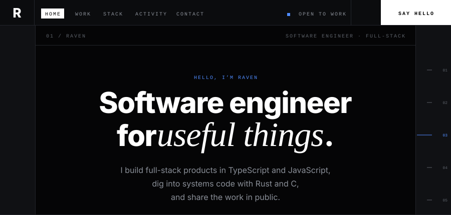

 

<a href="https://github.com/assem-elmasri?tab=repositories">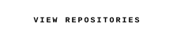</a>&nbsp;
<a href="mailto:your@email.com">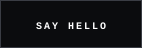</a>

  

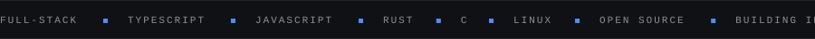

  

<!-- ============================ 02 / PROFILE ============================ -->
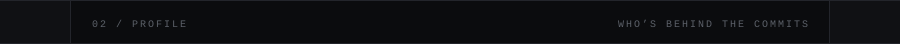

<table width="100%">
<tr>
<td width="26%" valign="middle" align="center">

</td>
<td width="74%" valign="middle" align="center">
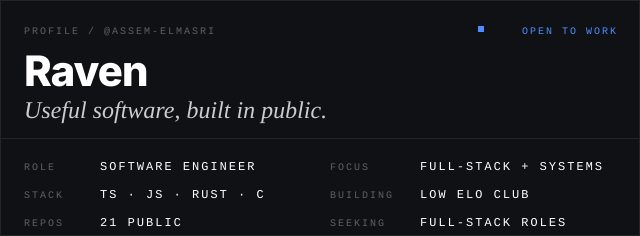
</td>
</tr>
</table>

 

<!-- ============================ 03 / SELECTED WORK ============================ -->
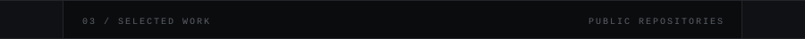

<a href="https://github.com/Assem-Elmasri/Low-Elo-Club-Front">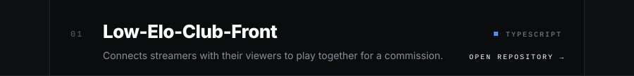</a>
<a href="https://github.com/Assem-Elmasri/ecoclean">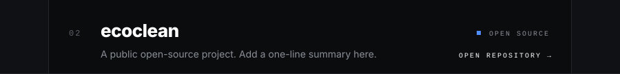</a>
<a href="https://github.com/Assem-Elmasri/Dotfiles">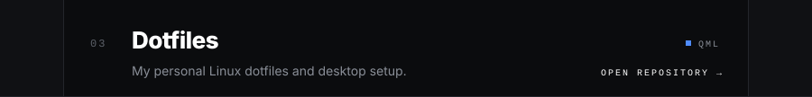</a>

 

  

<!-- ============================ 04 / TECH STACK ============================ -->
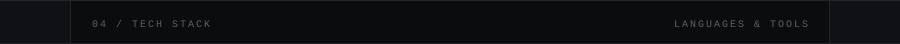
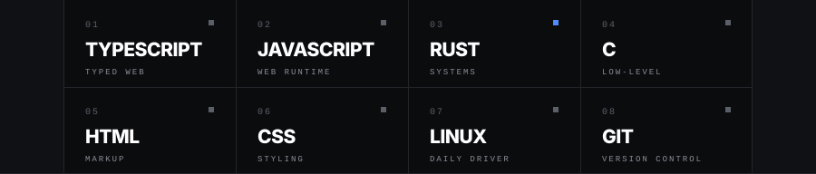

  

<!-- ============================ 05 / ACTIVITY ============================ -->
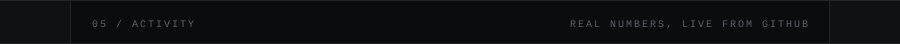

 

 

<!-- ============================ 06 / CONTACT ============================ -->
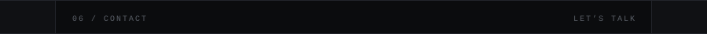
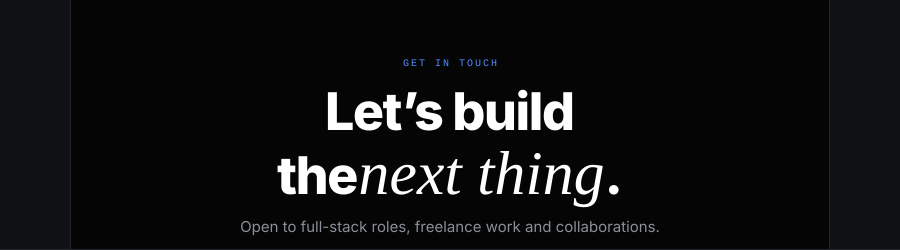

 

<a href="mailto:your@email.com">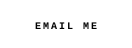</a>&nbsp;
<a href="https://linkedin.com/in/your-handle">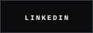</a>&nbsp;
<a href="https://github.com/assem-elmasri">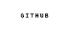</a>

  

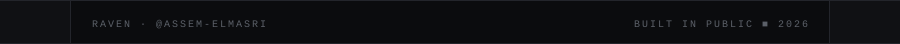

